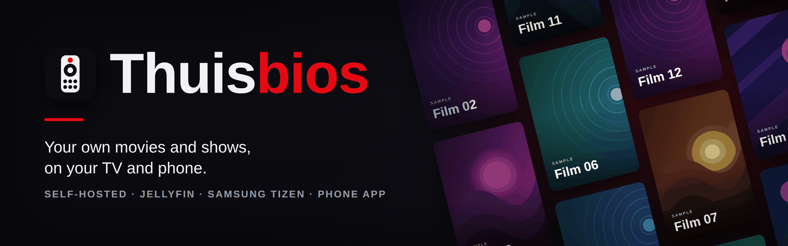
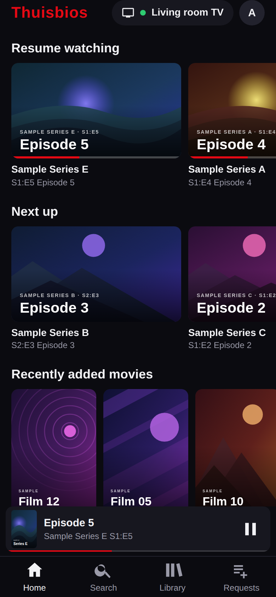
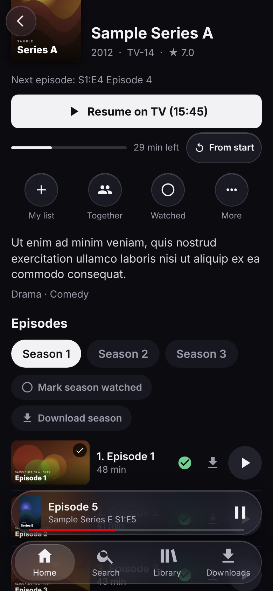
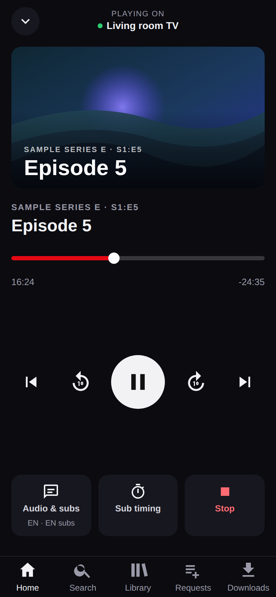
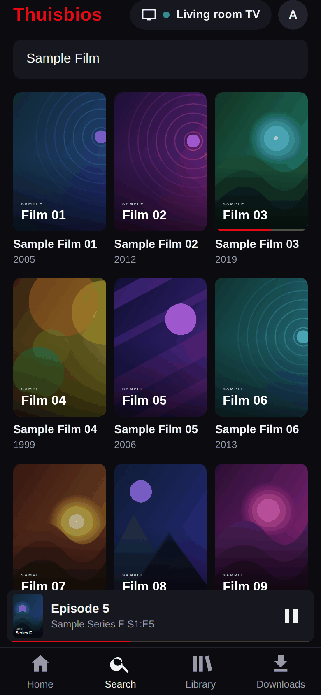
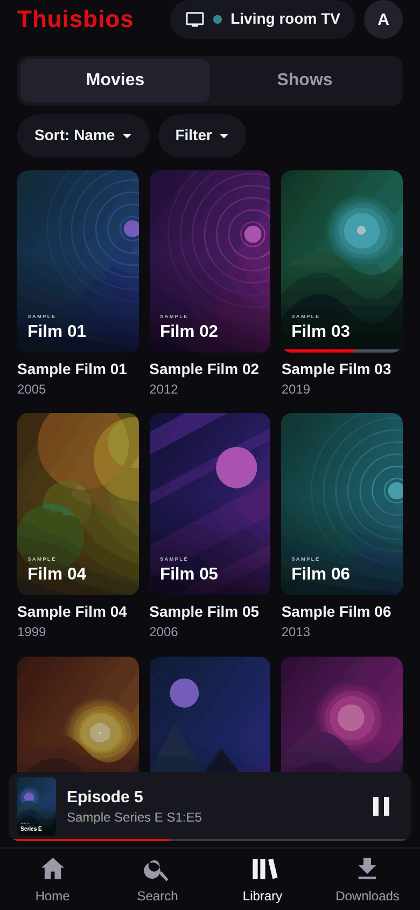
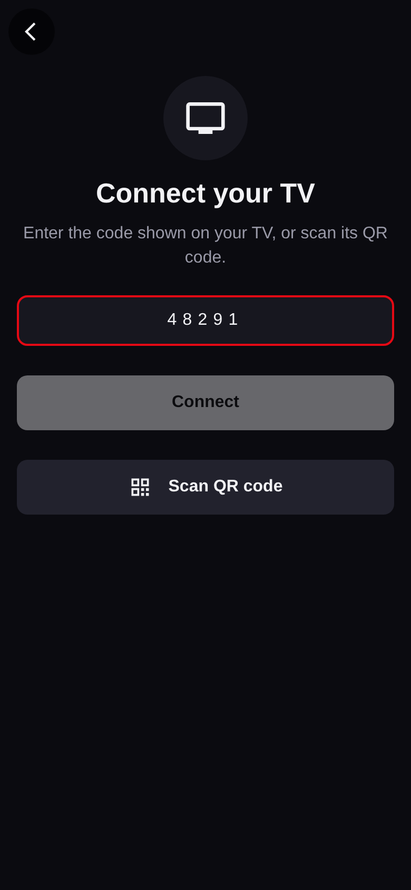
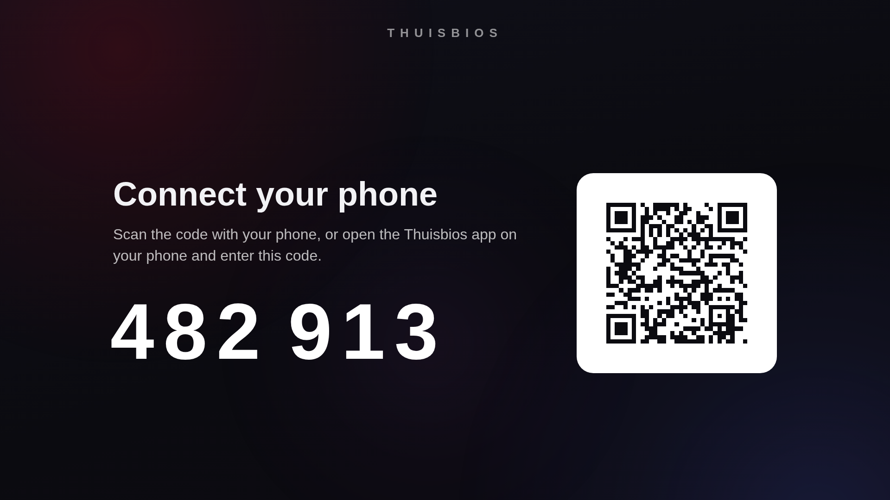
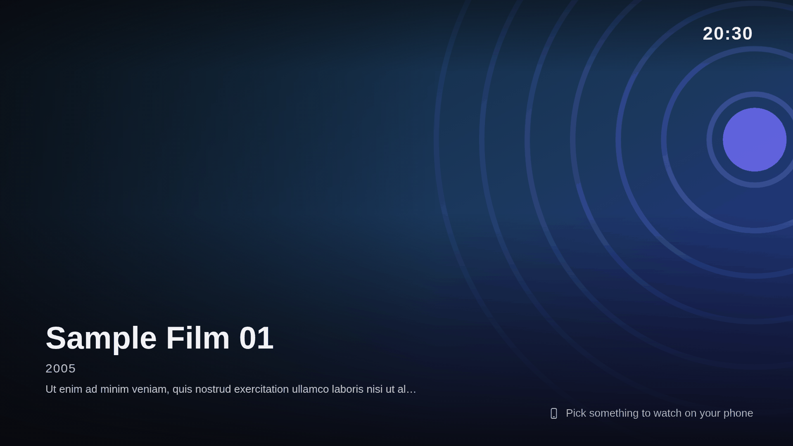

<h1 align="center">
  
</h1>

<p align="center">
  <a href="https://github.com/Pepijnvdliefvoort/thuisbios/actions/workflows/ci.yml"></a>
  <a href="https://github.com/Pepijnvdliefvoort/thuisbios/releases"></a>
  <a href="LICENSE"></a>
  <a href="https://www.conventionalcommits.org"></a>
  <a href="https://www.typescriptlang.org"></a>
  <a href="https://preactjs.com"></a>
  <a href="https://vite.dev"></a>
  <a href="https://jellyfin.org"></a>
  <a href="https://developer.samsung.com/smarttv"></a>
</p>

<p align="center"><strong>Your own movies and shows, on your TV and phone. Self-hosted on Jellyfin.</strong></p>

<p align="center">
  <a href="#screenshots">Screenshots</a> ·
  <a href="#features">Features</a> ·
  <a href="#how-it-works">How it works</a> ·
  <a href="#setup">Setup</a> ·
  <a href="#development">Development</a> ·
  <a href="#contributing">Contributing</a>
</p>

Thuisbios ("home cinema") is a personal streaming service for my own media at home.
[Jellyfin](https://jellyfin.org) is the backend, with two custom clients on its API: a phone and
desktop app (PWA) where you browse, search and play, and a Samsung Tizen TV page that connects with a
Quick Connect code or QR, shows a screensaver and plays what the phone sends. Plan: [docs/plan.md](docs/plan.md).

## Screenshots

All screenshots use a mocked Jellyfin server with placeholder titles and artwork.

### Phone app

<table>
  <tr>
    <td align="center"><br><sub>Home</sub></td>
    <td align="center"><br><sub>Series details</sub></td>
    <td align="center"><br><sub>Now Playing on the TV</sub></td>
  </tr>
  <tr>
    <td align="center"><br><sub>Search</sub></td>
    <td align="center"><br><sub>Library</sub></td>
    <td align="center"><br><sub>Connect a TV</sub></td>
  </tr>
</table>

### TV

<table>
  <tr>
    <td align="center"><br><sub>Connect with a code or QR</sub></td>
    <td align="center"><br><sub>Screensaver while idle</sub></td>
  </tr>
</table>

Regenerate them with `node scripts/screenshots/capture.mjs`, see [scripts/screenshots/README.md](scripts/screenshots/README.md).

## Features

Phone and desktop app (`apps/remote`):

- Home (with genre and "Because you watched" rows), search, library with sort and filter, collections, "More like this" and trailers.
  On desktop, Home opens with a full-width hero spotlight that shows picture previews of the other titles,
  and Resume watching cards show how much time is left.
- Details with cast and crew, seasons and episodes, watched marks, and title requests (with a notice on Home when a requested title arrives).
- My list: save movies and series for later from Details; they show as a row on Home (stored as Jellyfin favorites). The TV details page has the same button.
- Own player: resume, audio tracks, subtitles with timing, quality (on Auto, a 4K film that the server has to convert plays at 1080p), skip intro, next episode, scrub previews, chapter markers and list.
- Lock-screen and notification controls when playing on the phone: play/pause, 10 s skip, previous/next episode, title and artwork.
- Offline downloads that play without a network and sync progress back.
- Watch together: start a group from Details and others join from Home. Play, pause, seek and next episode apply to everyone.
  It uses Jellyfin's SyncPlay, so the Jellyfin apps can join too. An admin may need to allow it for a user
  (Dashboard > Users > SyncPlay access).
- A Jellyfin library named "Prive" or "Private" stays hidden by default; a per-device switch in the account menu shows it.
- Play on the TV, Now Playing remote (transport, tracks, subtitle timing, chapters) and TV volume.

TV page (`apps/tv`, Tizen 4.0):

- Connects with a Quick Connect code and QR, shows a screensaver, and plays on command of the phone.
- Full-screen HTML5 player with subtitles, skip intro, next episode and chapter markers.

## Roadmap

Ideas planned for later, not built yet:

- **Who's watching?** profile picker: when the app opens you get profile tiles. Each profile is its own Jellyfin account with its own watch progress, Continue watching, My list and access to the private library. Switch with one tap without a password, with an optional PIN per profile.

## How it works

```text
 Phone app ─────HTTP(S) + WebSocket──▶ Jellyfin (Linux home server) ◀──HTTP + WebSocket── TV app
 (PWA)                              VAAPI transcoding (AMD iGPU)                    (Samsung Tizen 4.0)
      │                                                                                    ▲
      └──── same-origin relay in the app's server (Docker, same machine) ──▶ Samsung TV remote API (volume) ┘
```

Jellyfin handles users, library, metadata, progress, search, images, transcoding and the sessions
(remote control) API; the phone sends commands to the TV session through it. The Thuisbios app (TV page
and phone app, one Docker image) runs next to Jellyfin, including the relay for TV volume and title requests.

## Setup

1. Run Jellyfin and the app on a Linux home server: [docs/server/linux-docker.md](docs/server/linux-docker.md).
   Releases publish the image to GHCR and a systemd timer keeps the server up to date.
2. Away from home: [docs/remote/tailscale.md](docs/remote/tailscale.md).
3. Optional, skip intro: [docs/server/intro-skipper.md](docs/server/intro-skipper.md). Scrub previews: [docs/server/trickplay.md](docs/server/trickplay.md).
4. Phone app, TV pairing and title requests: [docs/remote/setup.md](docs/remote/setup.md).
5. TV page (the TV's built-in browser): [docs/tv/dev-setup.md](docs/tv/dev-setup.md).

Older alternative on a Windows PC: [docs/server/windows-setup.md](docs/server/windows-setup.md).

## Development

```bash
npm ci
npm run dev -w apps/remote        # phone app at http://localhost:5174
npm run dev -w apps/tv            # TV page at http://localhost:5173
npm test                          # unit tests of all workspaces
npm run typecheck                 # tsc --noEmit in all workspaces
npm run build                     # production builds
node scripts/screenshots/capture.mjs   # regenerate the screenshots
```

```text
apps/tv/       Samsung Tizen 4.0 TV page (Preact + TypeScript + Vite)
apps/remote/   phone and desktop PWA, plus the relay (TV volume, title requests)
docs/          plan and setup guides (server, remote, tv), images
scripts/       repo tooling, mock Jellyfin and screenshots
server/        Windows helper scripts (Pester tests), Linux compose file and update timer
Dockerfile     one image with the TV page and phone app
```

## Contributing

Branch off `develop` (`feat/...`, `fix/...`, `docs/...`), use
[Conventional Commits](https://www.conventionalcommits.org) and open a PR into `develop`; PRs are
squashed. `main` holds releases only, cut by [release-please](https://github.com/googleapis/release-please)
(tag `vX.Y.Z`). See [CONTRIBUTING.md](CONTRIBUTING.md).

CI (`.github/workflows/ci.yml`) checks commit and branch names, Markdown, version consistency, and
typecheck, test and build of the changed parts. `release-please.yml` handles releases and pushes the Docker image to GHCR.

## License

Thuisbios is released under the [MIT License](LICENSE). It talks to Jellyfin only over its HTTP API and does not include Jellyfin code. Use it only with media you own or have the rights to.
