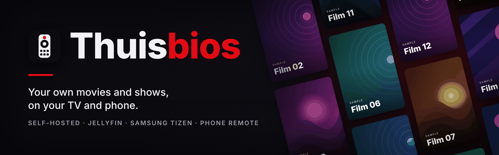
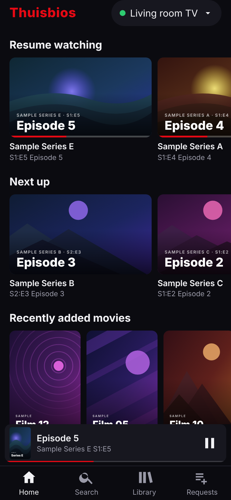
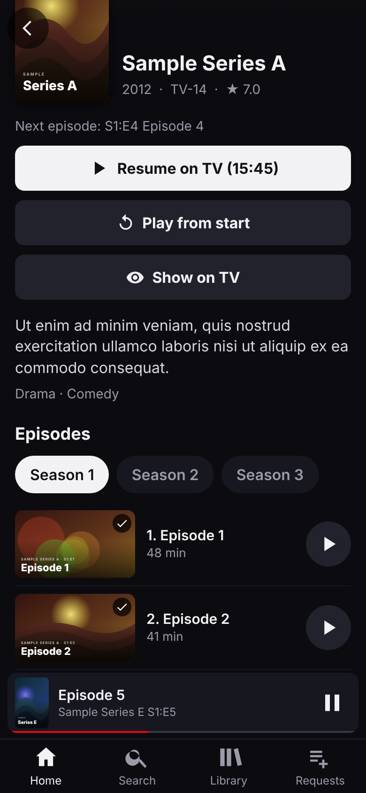
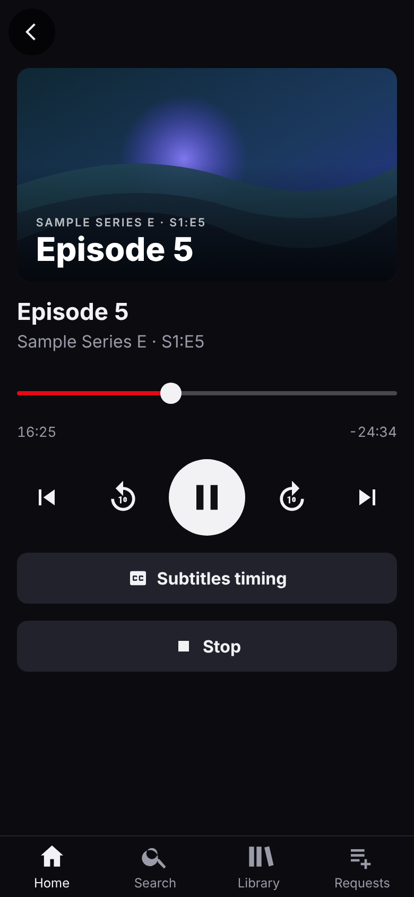
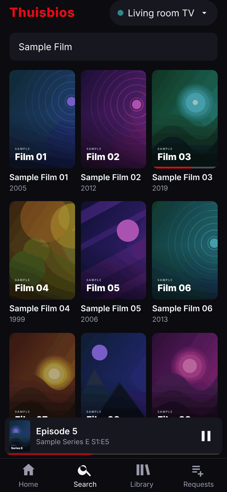
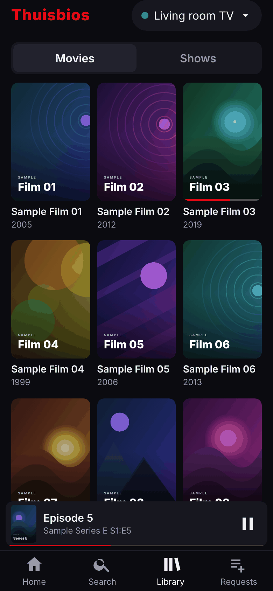
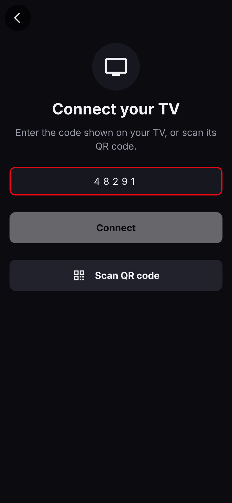
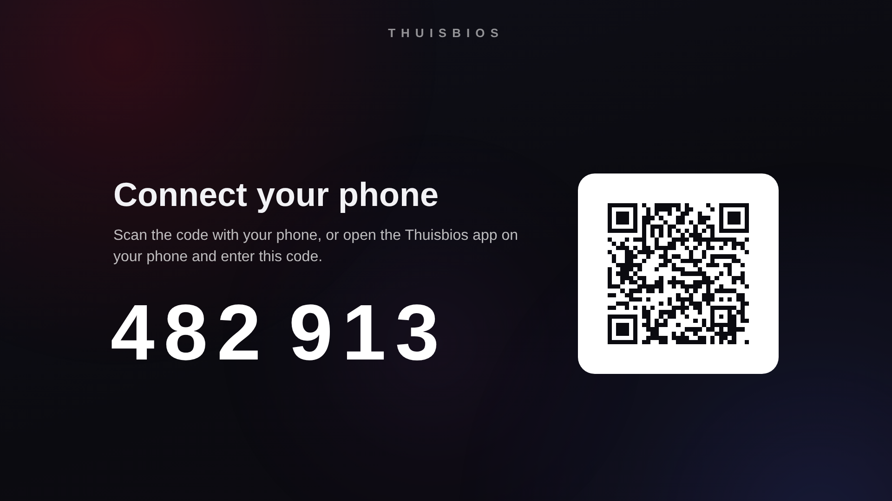
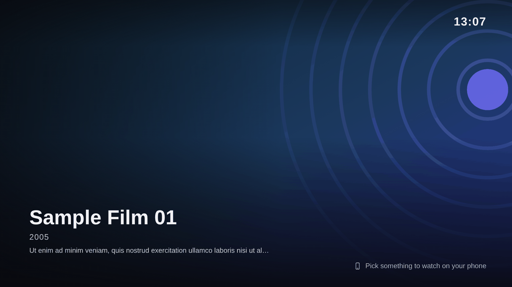

<h1 align="center">
  
</h1>

<p align="center">
  <a href="https://github.com/Pepijnvdliefvoort/thuisbios/actions/workflows/ci.yml"></a>
  <a href="https://github.com/Pepijnvdliefvoort/thuisbios/releases"></a>
  <a href="LICENSE"></a>
  <a href="https://www.conventionalcommits.org"></a>
  <a href="https://www.typescriptlang.org"></a>
  <a href="https://preactjs.com"></a>
  <a href="https://vite.dev"></a>
  <a href="https://jellyfin.org"></a>
  <a href="https://developer.samsung.com/smarttv"></a>
</p>

<p align="center"><strong>Your own movies and shows, on your TV and phone. Self-hosted on Jellyfin.</strong></p>

<p align="center">
  <a href="#screenshots">Screenshots</a> ·
  <a href="#architecture">Architecture</a> ·
  <a href="#server-phase-1">Server</a> ·
  <a href="#tv-app">TV app</a> ·
  <a href="#phone-app-phase-4">Phone app</a> ·
  <a href="#roadmap">Roadmap</a>
</p>

Thuisbios ("home cinema") is a personal streaming service for my own media at home.
[Jellyfin](https://jellyfin.org) is the backend. Two custom clients are built on top of its API:
a phone app (PWA) and a Samsung Tizen TV app. The phone app is the main app: you browse, search and
play with it, on the TV or on the phone itself. The TV app only connects (Quick Connect code and QR),
shows a screensaver and plays what the phone sends.

Full plan: [docs/plan.md](docs/plan.md).

## Screenshots

All screenshots use a mocked Jellyfin server with placeholder titles and artwork.

### Phone app

<table>
  <tr>
    <td align="center"><br><sub>Home</sub></td>
    <td align="center"><br><sub>Series details</sub></td>
    <td align="center"><br><sub>Now Playing on the TV</sub></td>
  </tr>
  <tr>
    <td align="center"><br><sub>Search</sub></td>
    <td align="center"><br><sub>Library</sub></td>
    <td align="center"><br><sub>Connect a TV</sub></td>
  </tr>
</table>

### TV

<table>
  <tr>
    <td align="center"><br><sub>Connect with a code or QR</sub></td>
    <td align="center"><br><sub>Screensaver while idle</sub></td>
  </tr>
</table>

Regenerate them with `node scripts/screenshots/capture.mjs`, see [scripts/screenshots/README.md](scripts/screenshots/README.md).

## Architecture

```text
 Phone remote ──HTTP(S) + WebSocket──▶ Jellyfin (Windows PC) ◀──HTTP + WebSocket── TV app
 (PWA)                              NVIDIA RTX 4060 Ti                          (Samsung Tizen 4.0)
      │                             NVENC transcoding                                  ▲
      └──── same-origin relay in the remote's server (PC) ──▶ Samsung TV remote API (volume) ┘
```

Jellyfin handles users, library, metadata, progress, search, image resizing, transcoding and the
sessions (remote control) API. The phone sends commands to the TV session through Jellyfin.

## Repository layout

```text
.github/                  CI, release and dependency automation, PR template
docs/plan.md              project plan
docs/images/              README banner and screenshots
docs/server/              Jellyfin setup guide for Windows (windows-setup.md), autostart guide (autostart.md) and Intro Skipper guide (intro-skipper.md)
docs/tv/                  TV app: Tizen setup, install and test guide (dev-setup.md)
docs/remote/              phone remote: setup guide (setup.md), away from home via Tailscale (tailscale.md)
scripts/                  repo tooling (version checks)
scripts/screenshots/      mock Jellyfin server and Playwright script that generates the README screenshots
packages/jellyfin-client/ planned: shared typed Jellyfin API client
apps/tv/                  Samsung Tizen 4.0 TV app (Preact + TypeScript + Vite), served to the TV browser
apps/remote/              phone remote PWA, phase 4 (Preact + TypeScript + Vite)
apps/remote/relay/        Samsung TV volume relay and title requests (Node, runs inside the remote's vite server); apps/remote/scripts/tv-setup.mjs pairs the TV and jellyfin-setup.mjs saves the Jellyfin API key for title suggestions
server/                   Jellyfin helper scripts (PowerShell) and Pester tests; device profile planned
```

## Server (phase 1)

Follow [docs/server/windows-setup.md](docs/server/windows-setup.md) to install Jellyfin natively
on Windows, enable NVENC, and set up the network. Helper scripts live in `server/scripts`
(Windows PowerShell 5.1 or PowerShell 7):

- `New-MediaLibrary.ps1`: create the Movies/Shows folders.
- `Get-TestMedia.ps1`: download Blender open movies and build a Jellyfin test library (needs ffmpeg).
- `Set-JellyfinFirewall.ps1`: allow TCP 8096 and UDP 7359 on the private network (administrator).
- `Test-JellyfinServer.ps1`: check that the server answers.
- `Install-ThuisbiosAutostart.ps1`: build the TV page and phone app and start them automatically
  with Windows (administrator; also adds the update task (every 30 minutes), `-NoAutoUpdate` skips it).
  `Uninstall-ThuisbiosAutostart.ps1` turns it off again, and `Start-ThuisbiosServer.ps1` is what
  the scheduled tasks run. See [docs/server/autostart.md](docs/server/autostart.md).
- `Update-Thuisbios.ps1`: move the project folder to the newest GitHub release (tag `vX.Y.Z`),
  build it and restart the TV page and phone app; goes back to the previous version if the build
  fails. Run by the Update task every 30 minutes (administrator; `-Force` rebuilds the current release).

Optional: the Intro Skipper plugin lets Jellyfin find the intro of each episode, which makes the apps
show a "Skip intro" button. See [docs/server/intro-skipper.md](docs/server/intro-skipper.md).

Run the tests with `Invoke-Pester -Path server/tests` (Pester 5).

## TV app

`apps/tv` is an npm workspace package: Preact + TypeScript + Vite, transpiled for Chromium 56
(Tizen 4.0) with `@vitejs/plugin-legacy`. The TV is no longer where you browse: it only connects
the account and shows a screensaver. It does not ask for a server address. It immediately shows a
Jellyfin Quick Connect code (6 digits) and a QR code; once the phone approves the code, the TV signs
in and shows a slideshow of the library. You pick and play things on the phone, and the TV plays them
through the Jellyfin sessions API. The old TV home rows, Movies, Shows and sidebar are removed. The
player is a full-screen HTML5 player (Jellyfin device profile, `?debug` overlay) with text
subtitles. In the TV browser, Return while in full screen only leaves full screen, so the app asks
for full screen again, and the "Press OK to continue in full screen" modal is handled with OK. Installing
(sideloading) a packaged app is refused by this TV's firmware, so the app runs in the TV's built-in
web browser, served from the PC (`npm run preview -w apps/tv`, port 4173).
[docs/tv/dev-setup.md](docs/tv/dev-setup.md) explains this and has the test checklist;
[docs/server/autostart.md](docs/server/autostart.md) starts it with Windows.

```bash
npm install
npm run dev -w apps/tv        # desktop browser at http://localhost:5173
npm test                      # unit tests of all workspaces
npm run typecheck             # tsc --noEmit in all workspaces
npm run build -w apps/tv      # apps/tv/dist, ready to package for Tizen
npm run check:dist -w apps/tv # build output must be ES2017 only
```

Signing and packaging (`npm run package -w apps/tv`) are kept for TVs that allow sideloading. They need the Tizen CLI and a Samsung
certificate, so they run on the owner's PC, never in CI. Certificates and `.wgt` files are never
committed.

## Phone app (phase 4)

`apps/remote` is the phone remote: a PWA ("Thuisbios Remote", Preact + TypeScript + Vite) for modern
phone browsers (iOS Safari 15+, Android Chrome), so there is no legacy build. The phone is the main
screen. It connects the TV: scan the QR code on the TV (the link is
`http://<pc>:4174/?connect=<code>`) or tap "Connect a TV" and type the 6-digit Quick Connect code
(the phone approves it with `POST /QuickConnect/Authorize`). The Connect a TV screen can also scan the
TV's QR code with the camera (over plain HTTP it takes a photo; a live viewfinder needs HTTPS). It signs in to
Jellyfin with just username and password (the server address is derived from the page host; "Change server" reveals it), browses the library (Home rows, Search, Library with
Movies and Shows) and shows a details page with Play on TV, Resume on TV, Play from start and Show
on TV; series and episode pages have a season selector and an episode list that marks watched episodes and the next or current one, and an episode page links back to its show. While the TV plays, a mini player bar and a
Now Playing screen offer play/pause, a scrub slider, -10 s / +10 s, previous and next episode and
stop. The remote finds the TV through the Jellyfin sessions API (the TV app registers as
remote-controllable) and polls `/Sessions` every 2 seconds while the page is visible.

The TV sheet in the header has "Disconnect from TV", which signs the TV out so it shows a new Quick
Connect code and QR again (the choice survives a reload). Reconnecting needs the code or the QR again.

Without a TV connected, the play buttons play the video on the phone itself: direct play when the
phone supports the file, otherwise the server converts it (HLS, through hls.js where the browser has
no native HLS). The phone plays in the app's own player, which fills the screen: tap the picture to
show or hide the controls (play/pause, -10 s / +10 s, a scrub bar and a subtitles picker). Text
subtitles are drawn by the app itself and the app remembers the subtitle language you picked; image
subtitles (the kind stored as pictures on some discs) are not supported. On Android the app goes
fullscreen and locks landscape. An iPhone cannot do that, so when the phone is held upright the
player turns the picture sideways by itself. This works with rotation lock on. iOS still shows the
status bar and home indicator in their upright places, and swipe gestures such as Control Center stay
upright. The phone reports its progress to Jellyfin, so it counts toward Resume watching.

The TV app now accepts remote-control commands through Jellyfin: the TV page registers as
remote-controllable and handles Play, Pause/Resume, Seek, Stop, Next/Previous episode, "Show on
TV" and Disconnect (sign out).

Every request uses the configured absolute server URL and there is no service worker, so the app can
be wrapped with Capacitor later. A volume button (Now Playing and the TV sheet) opens a bottom sheet
with a slider, a mute toggle and −/+ buttons (one step per tap) that control the Samsung TV through a small relay that runs inside
the remote's own `vite preview` (and `vite dev`) server on the PC, under `/api/tv/`. The phone calls it on the same origin with its
Jellyfin token, which the relay checks against Jellyfin; it only ever sends `KEY_VOLUP`,
`KEY_VOLDOWN` and `KEY_MUTE` over the remote API, and reads and sets the exact level through the TV's
UPnP RenderingControl service (port 9197). When UPnP is not available (for instance sound going to a
soundbar), or `"volumeMode": "relative"` is set, the slider presses the volume keys toward a remembered
level instead. The TV address and pairing token live in
`~/.thuisbios/samsung-tv.json`, outside the repo; `npm run tv:setup -w apps/remote -- <tv-ip>` pairs
the TV once. Follow [docs/remote/setup.md](docs/remote/setup.md) to run it on the PC and add it to
the phone's home screen.

Now Playing also has a "Subtitles" button that opens a sheet to shift the subtitle timing in steps of
0.1 s or 0.5 s (positive is later). The phone sends the absolute offset for the playing item as a private
Jellyfin display message (`thuisbios:subtitle-offset:<itemId>:<ms>`), the TV shifts the WebVTT cues and
remembers the offset per item. It only works for text subtitles.

The same relay serves title requests under `/api/requests`: when a search finds nothing, anyone signed
in can request a movie or show (just a title; picking a suggestion adds year, type and poster), and the Requests tab shows their
own requests with a status (Waiting, Added, Not added), where open ones can be withdrawn. The owner
(a Jellyfin administrator, checked by the relay through `GET /Users/Me`, never taken from the client)
sees all requests in that tab, marks them Added or Dismiss, and gets a badge with the open count on
the tab. Requests are stored in `~/.thuisbios/requests.json`, outside the repo; nothing is downloaded
automatically. While typing a title, the form suggests matches with a poster and year; the relay gets
them from Jellyfin's built-in metadata search (`GET /api/requests/lookup`) using a Jellyfin API key that
`npm run jellyfin:setup -w apps/remote` saves in `~/.thuisbios/jellyfin.json`. Without the key, requests
still work as plain text.

Away from home the phone reaches the PC through Tailscale Serve (private, tailnet only, nothing opened
to the internet): `https://<pc>.<tailnet>.ts.net` for the app (port 443) and `:8920` for Jellyfin, both
over HTTPS so the home-screen install works. Follow [docs/remote/tailscale.md](docs/remote/tailscale.md).

```bash
npm install
npm run dev -w apps/remote       # desktop browser at http://localhost:5174
npm test -w apps/remote          # Vitest
npm run build -w apps/remote     # apps/remote/dist
npm run preview -w apps/remote   # serves dist on the network, port 4174
npm run icons -w apps/remote     # regenerate the PWA icons (public/*.png)
npm run tv:setup -w apps/remote -- 192.168.1.156   # pair the Samsung TV once (volume button)
```

## Branching and releases

- `develop` is the continuously evolving integration branch.
- Work happens on feature branches off `develop`: `feat/...`, `fix/...`, `chore/...`, `docs/...`, `ci/...`, `refactor/...`, `perf/...`, `test/...`.
- Pull requests go into `develop`. The owner approves every PR.
- `main` holds stable releases only. It is updated by a release PR from `develop`, tagged `vX.Y.Z` (semver).
- [release-please](https://github.com/googleapis/release-please) maintains the changelog and version bump.

See [CONTRIBUTING.md](CONTRIBUTING.md) for the details.

## Commit convention

[Conventional Commits](https://www.conventionalcommits.org), enforced by commitlint:
`feat: ...`, `fix: ...`, `docs: ...`, `chore: ...`, `ci: ...`, `refactor: ...`, `perf: ...`, `test: ...`.

## CI overview

GitHub Actions in `.github/workflows`:

- `ci.yml`: commitlint (commits and PR title), branch-name check (PR branches must start with `feat/`, `fix/`,
  `chore/`, `docs/`, `ci/`, `refactor/`, `perf/` or `test/`), markdownlint, version consistency check (root,
  `apps/tv/package.json`, `apps/remote/package.json` and the Tizen `config.xml` must agree), TV app
  (typecheck, Vitest, build, ES2017 syntax check, `dist` uploaded as artifact), phone remote
  (typecheck, Vitest, build, `dist` uploaded as the `remote-dist` artifact), PowerShell (PSScriptAnalyzer and Pester tests
  for `server/` on Windows). The build and test jobs only run when their part of the repo changed (TV app,
  phone app, server scripts, Markdown, version files; a change to `ci.yml` runs everything). CI runs on pull
  requests into `develop` and `main` and on pushes to `develop`; runs on a PR are cancelled when a newer commit is pushed.
- `release-please.yml`: on push to `main`, opens or updates the release PR, creates the `vX.Y.Z` tag and GitHub release, and then opens a PR from `main` back into `develop`.

Dependabot updates GitHub Actions and npm weekly, targeting `develop`.
Docker image builds (GHCR) and the other test jobs are added together with the first containerized service.

## Roadmap

| Phase | Goal | Status |
|---|---|---|
| 1. Server | Jellyfin on the Windows PC with a test library | done |
| 2. TV spike | Hello-world Tizen app, D-pad focus, direct play and transcode playback | done |
| 3. TV MVP | Quick Connect login, profiles, home rows, detail page, playback with resume | done; later reshaped: the TV only connects and shows a screensaver, browsing moved to the phone |
| 4. Phone remote MVP | Search, browse, play on TV, transport controls, volume slider (TV or soundbar) | done: browse, search, play on TV or on the phone, transport controls, volume slider (relay in the remote's server), title requests; volume and title suggestions not yet verified on the real TV/phone |
| 5. Polish | Series flow, subtitles, trickplay, Samsung power-on/launch, remote access | in progress: remote access via Tailscale Serve and start with Windows and automatic updates from releases (autostart and update scripts, not yet run on the real PC) done; skip intro (needs the Intro Skipper plugin, on the TV and the phone; not yet verified on the real TV) done; next episode autoplay (card with countdown, on the TV and the phone; not yet verified on the real TV) done; the rest planned |

## License

Thuisbios is released under the [MIT License](LICENSE). It talks to Jellyfin only over its HTTP API and does not include Jellyfin code. Use it only with media you own or have the rights to.
